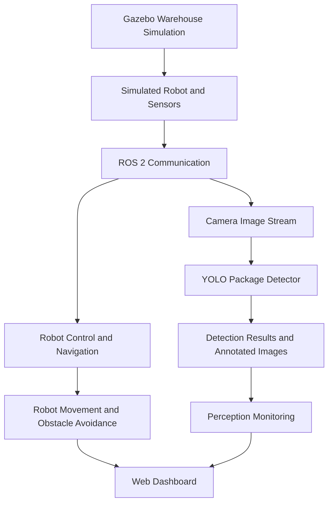

# RoboVerse: AI-Powered Digital Twin Platform for Autonomous Robot Simulation

<p align="center">
  
</p>

<p align="center">
  <strong>A ROS 2 and Gazebo-based warehouse robotics simulation integrating autonomous navigation, obstacle avoidance, camera-based package detection, and a web dashboard.</strong>
</p>

<p align="center">
  
  
  
  
  
  
</p>

---

## Table of Contents

- [Overview](#overview)
- [Project Objectives](#project-objectives)
- [Key Features](#key-features)
- [System Architecture](#system-architecture)
- [Technology Stack](#technology-stack)
- [Project Screenshots](#project-screenshots)
- [Prerequisites](#prerequisites)
- [Installation and Setup](#installation-and-setup)
- [Running RoboVerse](#running-roboverse)
- [Computer Vision Pipeline](#computer-vision-pipeline)
- [ROS 2 Topics and Communication](#ros-2-topics-and-communication)
- [Project Structure](#project-structure)
- [Testing and Evaluation](#testing-and-evaluation)
- [Current Limitations](#current-limitations)
- [Future Enhancements](#future-enhancements)
- [Research Background](#research-background)
- [Contributing](#contributing)
- [License](#license)
- [Acknowledgements](#acknowledgements)
- [GitHub Topics](#github-topics)

---

## Overview

**RoboVerse** is an AI-powered digital twin and autonomous robotics simulation project designed to demonstrate how robot simulation, computer vision, navigation, and monitoring can work together in a virtual warehouse environment.

The platform uses ROS 2 as the robotics middleware and Gazebo for simulation. A simulated mobile robot navigates the warehouse environment, uses sensor information to support obstacle avoidance, and receives camera input for YOLO-based package detection. A web-based dashboard provides an interface for observing and monitoring the system.

The project aims to make experimentation with autonomous warehouse robotics more accessible without requiring a physical warehouse robot.

RoboVerse is an academic software prototype. Its current focus is integrating the major robotics components into a working simulation and providing a foundation for further evaluation and improvement.

## Project Objectives

- Develop a simulated warehouse environment for autonomous mobile robotics.
- Integrate robot description, simulation, and control using ROS 2.
- Demonstrate autonomous patrol and obstacle avoidance.
- Integrate camera-based object detection using a trained YOLO model.
- Connect perception and robot operation through ROS 2 topics.
- Provide a web-based dashboard for observing the simulated system.
- Establish a foundation for evaluating detection performance and autonomous behaviour.

## Key Features

| Feature | Description |
|---|---|
| Warehouse simulation | A virtual warehouse environment implemented with Gazebo. |
| Autonomous robot movement | Simulated robot patrol behaviour through configured waypoints. |
| Obstacle avoidance | Robot control behaviour designed to avoid obstacles in the environment. |
| Camera integration | Simulated camera provides image data to the perception pipeline. |
| YOLO package detection | A trained model predicts the `package` object class from camera images. |
| ROS 2 integration | Separate robotics components communicate through ROS 2 topics and packages. |
| Web dashboard | A browser-based interface for monitoring the RoboVerse system. |
| Modular architecture | Simulation, control, perception, interfaces, and task management are organized into separate packages. |

## System Architecture

RoboVerse follows a modular robotics architecture in which the simulator, robot control, perception pipeline, and dashboard work together.



### Architecture components

**1. Simulation layer**

Gazebo provides the virtual warehouse, simulated robot, and sensor environment. It enables testing without a physical robot.

**2. Robotics middleware**

ROS 2 Jazzy connects the different packages through topics, launch files, and robot-control interfaces.

**3. Control and navigation layer**

The control and navigation components manage robot movement and patrol behaviour within the simulated environment.

**4. Computer vision layer**

The camera image stream is processed by a YOLO-based detector trained to identify the `package` class. The detector publishes detection information and an annotated image.

**5. Monitoring layer**

The web dashboard provides a visual interface for monitoring the simulation. The perception and control components operate as part of the wider RoboVerse system.

## Technology Stack

| Technology | Purpose |
|---|---|
| ROS 2 Jazzy | Robotics middleware and communication |
| Ubuntu 24.04 | Development and runtime environment |
| Gazebo Harmonic | 3D robot and warehouse simulation |
| Python | Robotics nodes and supporting logic |
| YOLO / Ultralytics | Camera-based object detection |
| OpenCV and NumPy | Image processing |
| RViz / `rqt_image_view` | Visualization and camera inspection |
| Web dashboard | Browser-based system monitoring |
| WSL 2 | Running Ubuntu on Windows |

## Project Screenshots

Screenshots should show the actual running application, not mock-ups.

### 1. Gazebo warehouse simulation


*Replace this image with a screenshot of the running Gazebo warehouse and simulated robot.*

### 2. RoboVerse web dashboard


*Replace this image with a screenshot of the actual dashboard at `http://localhost:8080`.*

### 3. Camera-based package detection


*Replace this image with an actual camera-view screenshot showing the detector's bounding boxes and confidence labels, when available.*

### Adding screenshots

Create the image directory if it does not exist:

```bash
cd ~/warehouse_robot_ros2
mkdir -p docs/images
```

Save your genuine screenshots into that directory using these filenames:

- `gazebo-warehouse.png`
- `roboverse-dashboard.png`
- `package-detection.png`

You may also add `roboverse-banner.png` if you create a project banner. Until the corresponding image files are added, these Markdown image links are placeholders and will not display screenshots on GitHub.

## Prerequisites

The documented environment for this project is:

- Ubuntu 24.04, including Ubuntu running through WSL 2 on Windows.
- ROS 2 Jazzy.
- Gazebo Harmonic.
- Python and the dependencies required by the project packages.
- A working graphical environment for Gazebo and visualization tools.
- A browser for accessing the dashboard.
- The trained YOLO model included in the repository.

For computer vision inference, the project uses a dedicated Python virtual environment named `.venv-yolo` in the development setup. The system Python and YOLO virtual environment should not be treated as interchangeable.

Hardware acceleration depends on the available drivers, libraries, and configuration. A GPU is not a universal prerequisite for running the ROS 2 simulation, although inference performance may vary.

## Installation and Setup

### 1. Clone the repository

Open an Ubuntu terminal and run:

```bash
git clone https://github.com/Roshanmathewe/Roboverse.git
cd Roboverse
```

If the repository contains the complete project on a branch other than `main`, check out that branch before proceeding.

### 2. Source ROS 2 Jazzy

```bash
source /opt/ros/jazzy/setup.bash
```

Confirm that ROS 2 is available:

```bash
ros2 --version
```

If the command is not recognized, verify that ROS 2 Jazzy is installed and that the terminal is running Ubuntu 24.04.

### 3. Build the workspace

From the repository root:

```bash
colcon build --symlink-install
```

After a successful build, source the workspace:

```bash
source install/setup.bash
```

The expected workspace includes packages for bringup, control, description, interfaces, perception, simulation, and task management.

### 4. Verify the packages

```bash
colcon list
```

The project packages should include:

- `warehouse_bringup`
- `warehouse_control`
- `warehouse_description`
- `warehouse_interfaces`
- `warehouse_perception`
- `warehouse_simulation`
- `warehouse_task_manager`

If a package is missing or the build fails, inspect the terminal error before attempting to run the simulation.

### 5. Verify the startup script

The project includes a startup script in the repository root:

```bash
ls -l start_roboverse.sh
```

If the script does not have execute permission, grant it:

```bash
chmod +x start_roboverse.sh
```

The script expects the project to be located at `~/warehouse_robot_ros2` in the current development setup. If you cloned it into another directory, review the script's project path before launching it.

## Running RoboVerse

### Start the simulation

From the project directory:

```bash
cd ~/warehouse_robot_ros2
./start_roboverse.sh
```

The startup script is designed to launch the Gazebo simulation and associated ROS 2 components, followed by the web dashboard.

Keep the terminal open while RoboVerse is running.

### Open the dashboard

In your browser, visit:

**http://localhost:8080**

The dashboard should be accessible while its server is running and port `8080` is available.

### View the camera and detections

To inspect the camera feed or annotated detection images, open another Ubuntu terminal and source the project environment:

```bash
cd ~/warehouse_robot_ros2
source /opt/ros/jazzy/setup.bash
source install/setup.bash
```

Launch the image viewer:

```bash
ros2 run rqt_image_view rqt_image_view
```

Select the appropriate image topic from the viewer. For example, the detector's annotated output is published on:

```text
/detections/image
```

The raw camera feed is published on:

```text
/camera/image
```

### Stop the simulation

Return to the terminal running the startup script and press:

```text
Ctrl+C
```

This requests the running processes to stop. If a process does not exit cleanly, inspect it before starting another instance.

## Computer Vision Pipeline

RoboVerse includes a YOLO-based computer vision component for package detection in the simulated warehouse.

### Processing workflow

1. The simulated camera produces an image.
2. ROS 2 publishes the image on `/camera/image`.
3. The perception node passes the image to the trained YOLO model.
4. The model predicts bounding boxes and confidence scores for objects it recognizes as packages.
5. The node publishes detection information on `/detections`.
6. An annotated image is published on `/detections/image` for visualization.

### Model details

| Parameter | Current project configuration |
|---|---|
| Model | Trained YOLO model |
| Model file | `src/warehouse_perception/warehouse_perception/models/package_detector.pt` |
| Target class | `package` |
| Configured inference image size | 960 |
| Configured confidence threshold | 0.25 |
| Input image topic | `/camera/image` |
| Detection data topic | `/detections` |
| Annotated image topic | `/detections/image` |

The configured threshold is not a measure of achieved accuracy. Detection confidence is a model output, not proof that the prediction is correct.

### Inspect detection messages

To inspect detection output:

```bash
ros2 topic echo /detections
```

Messages contain a JSON string describing the current detection results. An empty detection list means the detector did not report an object in that particular message.

To check the image topic:

```bash
ros2 topic info /camera/image
```

To observe the camera publication rate:

```bash
ros2 topic hz /camera/image
```

These commands help diagnose the pipeline but do not independently establish detection accuracy.

## ROS 2 Topics and Communication

The following topics are relevant to the current perception workflow.

| Topic | Purpose |
|---|---|
| `/camera/image` | Simulated camera image stream |
| `/detections` | Detection results published as a string message |
| `/detections/image` | Annotated image output from the detector |

Additional control, navigation, odometry, LiDAR, and simulation interfaces are configured within the project packages and launch files. Their exact topic names may depend on the selected launch configuration.

To inspect available topics while the system is running:

```bash
ros2 topic list
```

To inspect the message type and publisher/subscriber counts:

```bash
ros2 topic info /detections
```

## Project Structure

The repository is organized into ROS 2 packages.

```text
warehouse_robot_ros2/
├── src/
│   ├── warehouse_bringup/
│   │   └── ...                 # System bringup and dashboard
│   ├── warehouse_control/
│   │   └── ...                 # Robot control
│   ├── warehouse_description/
│   │   └── ...                 # Robot description and models
│   ├── warehouse_interfaces/
│   │   └── ...                 # Custom ROS 2 interfaces
│   ├── warehouse_perception/
│   │   └── warehouse_perception/
│   │       ├── models/
│   │       │   └── package_detector.pt
│   │       └── yolo_detector_node.py
│   ├── warehouse_simulation/
│   │   └── ...                 # Gazebo world and launch files
│   └── warehouse_task_manager/
│       └── ...                 # Task and patrol management
├── docs/
│   └── images/                 # Project screenshots
├── start_roboverse.sh          # Startup script
├── README.md
├── .gitignore
└── ...
```

This is a high-level overview. Individual package directories may contain additional launch files, configuration files, models, and source code.

## Testing and Evaluation

RoboVerse can be evaluated through separate tests for simulation, navigation, perception, and integration.

| Test area | What to observe | Evidence to collect |
|---|---|---|
| Simulation startup | Gazebo and robot launch successfully | Screenshot and startup logs |
| Robot movement | Robot follows its configured patrol behaviour | Video or recorded observations |
| Obstacle avoidance | Robot responds to obstacles in the environment | Repeatable test scenarios |
| Camera pipeline | Camera images are published and visible | Camera screenshot and topic information |
| Object detection | Packages are detected with appropriate bounding boxes | Ground-truth examples and prediction records |
| System integration | Dashboard and ROS 2 components operate together | Screenshots and logs |
| Runtime stability | System remains responsive during repeated runs | Run duration and error logs |

### Recommended computer vision metrics

For a future quantitative evaluation, use a labelled test dataset and calculate:

- **Precision:** The proportion of predicted package detections that are correct.
- **Recall:** The proportion of actual packages that the detector successfully identifies.
- **F1-score:** The harmonic mean of precision and recall.
- **Inference latency:** The time taken to process an image.
- **Detection throughput:** The number of images processed per second.

These metrics should be calculated from recorded predictions and ground-truth annotations. No numerical accuracy, precision, recall, or F1-score is claimed here without a corresponding evaluation result.

## Current Limitations

RoboVerse is an ongoing academic prototype, and several areas require further evaluation.

- **Detection consistency:** The detector may miss packages in some camera views.
- **Confidence variation:** Predicted confidence can vary with object distance, orientation, visibility, and background appearance.
- **False positives:** Rectangular objects or visually similar structures may be incorrectly classified as packages.
- **Runtime stability:** The simulation and perception pipeline need repeatable stress testing to identify and address freezing or performance bottlenecks.
- **Quantitative evaluation:** Detection accuracy must be established using labelled data rather than isolated successful predictions.
- **Simulation-to-real transfer:** Performance in Gazebo does not automatically establish performance on a physical robot.

These limitations define opportunities for further development rather than evidence that the complete system has been quantitatively validated.

## Future Enhancements

Potential improvements include:

1. **Improve package detection:** Expand and diversify the training dataset with package and non-package examples.
2. **Evaluate model performance:** Establish a labelled test set and calculate precision, recall, F1-score, and latency.
3. **Reduce false positives:** Evaluate visually similar objects and improve the training data or model selection.
4. **Improve runtime stability:** Profile CPU, memory, and GPU usage during simultaneous simulation and inference.
5. **Enhance monitoring:** Display useful perception and navigation status information in the dashboard.
6. **Improve repeatability:** Create repeatable test scenarios for package visibility, distance, lighting, and obstacle placement.
7. **Explore 3D perception:** Investigate depth-based perception and spatial reasoning as future extensions.
8. **Investigate sim-to-real transfer:** Explore whether models trained in simulation generalize to real camera images.

These are proposed future enhancements, not features claimed to be fully implemented.

## Research Background

RoboVerse draws on established research areas in computer vision and robotics:

- Redmon et al. (2016), *You Only Look Once: Unified, Real-Time Object Detection* — real-time object detection.
- Qi et al. (2017), *PointNet: Deep Learning on Point Sets for 3D Classification and Segmentation* — point-cloud perception.
- Campos et al. (2021), *ORB-SLAM3: An Accurate Open-Source Library for Visual, Visual-Inertial and Multi-Map SLAM* — visual localization and mapping.
- Tobin et al. (2017), *Domain Randomization for Transferring Deep Neural Networks from Simulation to the Real World* — synthetic visual variation and sim-to-real transfer.

These works provide background for the relevant research areas; they should not be interpreted as evidence that PointNet, ORB-SLAM3, or domain randomization is implemented in the current RoboVerse system.

## Contributing

Contributions, suggestions, and bug reports are welcome.

1. Fork the repository.
2. Create a branch for your proposed change.
3. Keep changes focused and test the affected ROS 2 packages.
4. Document any new dependencies or launch instructions.
5. Submit a pull request describing the change and the tests performed.

Please avoid committing generated build folders, temporary logs, local virtual environments, or large datasets unless they are explicitly needed and appropriately documented.

## License

No license is specified in this README.

Before publishing the repository for reuse, add a `LICENSE` file containing the license you have chosen and have the right to apply. Until a license is added, do not assume that others have permission to redistribute or modify the project.

Also review the licenses of third-party code, pretrained weights, datasets, and other assets included in the repository.

## Acknowledgements

RoboVerse builds on the ROS 2 robotics ecosystem, Gazebo simulation tools, Python-based computer vision libraries, and the Ultralytics YOLO framework.

The project is intended for academic demonstration, experimentation, and further development in autonomous robotics and computer vision.

## GitHub Topics

Suggested repository topics:

`robotics` · `ros2` · `ros2-jazzy` · `gazebo` · `gazebo-harmonic` · `digital-twin` · `computer-vision` · `yolo` · `object-detection` · `autonomous-robot` · `mobile-robot` · `warehouse-automation` · `robot-simulation` · `ubuntu` · `python`

---

<p align="center">
  <strong>RoboVerse — Simulate. Perceive. Navigate. Improve.</strong>
</p>
